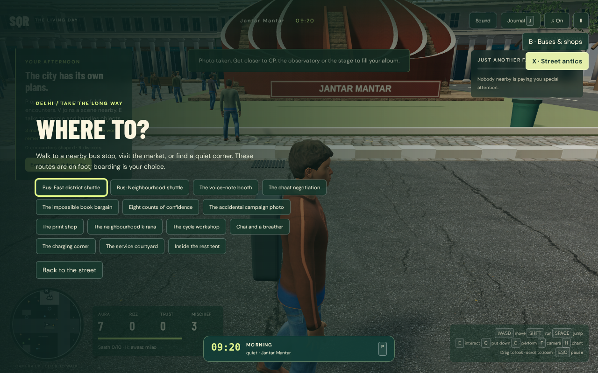

# Side Quest Republic: why the Codex build isn't playable

Review of `main` at `3d41db0` (v27) plus the full Codex conversation ([codex-transcript.md](codex-transcript.md)). Three parallel reviews: dialogue, playable verbs (with a ~4 min headless playtest), and story wiring. Line numbers in `dist/` refer to a prettified copy, since the shipped files are minified.

## The short version

The game has **lots of story data and very little game**. 24 encounters and 100 choices exist, but they live in a menu, write mostly to numbers nobody reads, and almost never change what you see. The mischief the game was pitched on (bus keys, pestering police, helping detainees) is either dialogue-only or a heat bump. Six separate state systems were bolted together instead of one story spine.

## 1. Dialogue repeats because every scene is stamped from one template

Copy-paste duplication is low (0 exact duplicate lines). The repetition is **structural**:

- 22 of 24 scenes have a single NPC speaker. 98 of 100 choices get exactly 2 response lines; in 84 of them the first line is just the button label read back. Then one quip, scene over. No interruptions, no reversals, no third voice.
- Option order is fixed: slot 0 is "helpful" in 24/24 scenes, slot 3 is a neutral walk-away in 24/24 (17 are "Main side / nikal raha hoon"), and every disruptive choice sits in slot 1–2. Helpful choices average +7.4 trust; neutral +0.1. The "right" answer is obvious.
- About 11 of 24 premises are "information is incomplete, verify it" (headcount, source, affiliation, edits). 40 of 259 spoken lines are care/consent advice ("pooch lena", "saath chalna"). Scene cards and callbacks are formal English narration (22/24 descriptions, 33/40 callbacks).
- Ambient chatter cycles tiny pools: 4 fixed street exchanges, 2 lines per escalation stage (the 240 s assembly stage can repeat the same 2 lines ~20 times), and all crowd NPCs share one recruit line plus 3 rotating lines chosen by `sim.time % 3` (`main.js:97`).

Root cause: `stageDayEncounters` in `dist/staged-scenes.js:32` generates every scene as actor + 2 openers + "echo label, one reply" per choice. When you flagged the lecturing tone (transcript, 15 Oct 15:09), Codex rewrote the words in that file but kept the template.

## 2. Not much to do, and doing things doesn't show

| Player action | What actually happens |
|---|---|
| Move, run, jump, ride bus between districts | Physical, works |
| Carry speaker / phone / key / water (only 4 objects) | Physical pickup; connecting the speaker plays music and grows the crowd |
| **Take the bus key** | +mischief, heat jumps, police chase. **The bus never stops.** `keyTaken` is only read by the recap (`campaign.js`) |
| Ask police for advice, X "street antics" (6 options) | 3-line bubble, nearby NPCs gesture for 9 s, +2–5 aura. Nothing in the world changes |
| Pose / chant / photo | Toast and stats only (chant in play: "Pehle crowd jodo · +0") |
| 24 day encounters, 100 choices | Of 250 effects, only 20 touch escalation/tension/pressure; 78 set flags used mostly to gate later text |
| 12 shops | A line and stats |
| Help detained people | Exists only as dialogue text |
| Crowd-crisis tasks (escort, keep passage, mic repair) | The one system where things visibly move, but it is driven by the clock, not by your mischief |

Codex's own audit (16 Oct): only **10–12 of 76** choices change anything visible within a minute; **27–29** change nothing visible all day.

Playtest: no console errors, but after the opening talk, 8 walking segments found **zero** interaction prompts, the antics tray said "Walk closer to someone", heat never moved, the clock stayed "morning · quiet", and the objective panel stayed on "The city has its own plans." The original speaker/phone/key errands are hidden unless you're already carrying something (`main.js:1731`). The HUD covers about 40% of the screen:

## 3. The story is a network of states, not a progression

Six state systems, joined by hand-written bridges:

1. Arcade sim: heat, aura, trust, mischief, 4 chase cops (`simulation.js`)
2. Original 3-quest campaign object (`main.js`, `social.js`)
3. Living world: 12 actors, 5 districts, 3 institutions, 24 encounters, 10-beat schedule (`living-world.js`)
4. Escalation director, recomputed every tick (`escalation-director.js`)
5. Projection modules with their own state: crowd crisis, story tasks, crisis tasks, street incidents, mischief
6. Day UI state: reels, cast leases, scene runs (`day-client.js`)

There are 4 different "trust" values and 3 police systems. Consequences:

- **The escalation arc isn't player-driven.** The lathi-charge wave needs command pressure ≥ 35, which only happens at the scheduled `orders_change` beat (~13 min in) whatever you do. Provocateurs are a 4-body cohort that points. Mischief events are logged as type `mischief`, which the director ignores.
- **"Who police target" is computed and never used.** `police.focus` is not read by any runtime code. The hotspot locks at t ≥ 720 and only 3 scenes can move it.
- **Endings:** the original 4-title campaign ending is unreachable (the day ending always takes over, `main.js:153`) but its "x/3 stories" counter still shows in the HUD. The day ending headline is decided almost entirely by late choices.
- **Dead complexity:** 12 actor fields (fears, personality, obligations, 7 profile subfields…) that nothing reads, which is 144 values across 12 actors. `credibility` is written by 39 choices and read nowhere; `fatigue` by 22 and read nowhere. **42 of 66 story flags are never read.**
- A developer "why did they do that" inspector ships inside the player's story menu.
- The end-to-end playable-day test fails (`storyReserved is not defined`). That's a stale test harness, not a game crash, but it means there has been no working whole-day check.

## 4. How it drifted (from the conversation)

1. **15 Oct 07:03 / 07:34.** You asked for a funny escape game (bus keys, police advice, chase). This produced the arcade sim, and it was the right core.
2. **10:11.** "More depth, reels like GTA cutscenes." Codex added a 3-quest campaign alongside it instead of deepening the core.
3. **10:32.** "An independent story running in the background, every choice adds up." Codex started a second, separate simulation instead of driving the existing one.
4. **11:29 / 11:47.** "Goals, fatigue, fear hardly begins to describe the depth, add more parameters" plus the inspector and seeded-day tests. Codex took this literally and built a parameter explosion that behaviour mostly doesn't read.
5. **22:08.** You described the arc you wanted: police, hidden provocateurs, a showdown whose location depends on you. Codex built it as a derivation layer feeding text and stats, not as set pieces you play.
6. **16 Oct 10:13 and 17:03.** You asked "is it playable or just story?" Its audit said mostly story. Codex answered by adding more modules (story tasks, crisis tasks) instead of cutting.

The pattern: every "make it deeper" request was met by **adding a layer** rather than **connecting what existed**. Its progress reports measured that state stayed valid ("4,500 choice pairs, 0 failures"), not that a player could see or feel a consequence.

## 5. What would fix it (highest leverage first)

1. **Cut to one state model and one story spine.** Delete the legacy campaign path, duplicate trusts and extra police systems, plus the unread actor fields, credibility, fatigue and dead flags. Move the inspector to a dev-only flag.
2. **Make the director's three levers (intensity, showdown location, police target) the whole story, and let mischief move them.** Fire the schedule beats as physical set pieces (arrival wave, police line, provocateur incident, lathi charge) gated on intensity, so your play makes the charge come early or late, here or there, and makes police go after different people.
3. **Make every mischief verb change the world.** The key should strand the bus, with a driver searching and passengers spilling out. Antics should leave a crowd, a camera crew or a spilled prop behind. Detainees should be at a van you can actually free. Put something interactable within 10 m of the start.
4. **Replace 24×100 menu scenes with 6–8 street decisions at those beats**, each with 2–3 speakers, interruptions and no obvious "safe" slot. Wire the flags that remain to characters remembering what you did.
5. **Add a big pool of non-repeating background lines** (8–15 per stage, ambient type and NPC personality) and shrink the HUD to one objective card and a heat bar.
6. **Judge by playing.** Run a whole day at normal speed with an idle, a chaotic and a helpful player, and check that the screen looks different at the end. Valid state is not the target.
