# Game map

Generated by `npm run verify` from the engine, `dist/loop/content.js` and the latest exploration. Do not edit by hand.

**Reachable by a player:** 11/13 endings, 37/42 rules, 57/63 board links fire, 57/63 can be learned (the player hears them). **Intended routes that work:** 11/17. **Verbs that change an outcome:** 8/12.

A "witness" is the shortest plan the checker found that reaches the item; every ending's witness is in `verify/traces/` and plays in the game: serve the repo root and open `/dist/index.html?replay=/verify/traces/<file>` (see `verify/README.md`).

## Endings

| Ending | Title | Reached by | Intended route |
|---|---|---|---|
| `detained` | Detained before lunch | **unreached** | — |
| `viral` | Dhakka-mukki, live | 10:10, whisper dev minister | minister-viral: works |
| `scuffle` | Vans at the barricade | 10:10, whisper dev minister, walk to phoneCart, 13:12, take phone, walk to metro | minister-no-phone: works |
| `march` | March on Parliament Street | 10:20, pester sharma career, pester sharma cute, pester c4 cute | key-to-march: **broken** |
| `roast` | Rao, over | 10:05, talk nikhil, walk to metroPath, walk to -3,-1, 14:20, take megaphone, give kabir, walk to metro | kabir-roast: works |
| `singalong` | Hum honge kaamyaab | 14:20, take megaphone, give mira, walk to metro | megaphone-singalong: works |
| `heat` | Ambulance at Jantar | take water | water-hidden-heat: works |
| `ghost` | Ghost town | walk to phoneCart, 13:12, take phone, walk to metro, 14:20, whisper mira cannon | phone-scare-ghost: works |
| `biryani` | The great biryani hunt | **unreached** | biryani-ending: **broken** |
| `cpjam` | CP chakka jam | 10:20, pester sharma career, pester sharma cute, talk asha, pester sharma cute, walk to crowd:cp, rally, walk to crowd:stage, … (16 steps) | speaker-and-key-cpjam: **broken** |
| `noshow` | Minister no-show | 10:10, whisper dev minister, 14:20, take megaphone, walk to metro | minister-no-megaphone: works |
| `packed` | Jantar Mantar packed | do nothing | — |
| `quiet` | Ek aur shaant din | 10:20, pester sharma career, pester sharma cute, talk asha, pester sharma cute, walk to crowd:cp, rally, walk to crowd:stage, … (16 steps) | speaker-gone: **broken** |

## Intended routes

Designer claims from `verify/seeds.mjs`, played the way a player can (walking, real witnesses).

| Route | Status | Why |
|---|---|---|
| speaker-gone | **broken** | missing ending:quiet, link:small-speech. speaker taken at 10:09 in sight of ravi |
| key-to-march | **broken** | missing ending:march, link:key-missing, link:cp-piles-up, link:rao-sends-sharma, link:march. key taken at 11:05 in sight of c2 |
| key-caught | works |  |
| key-returned | **broken** | missing link:key-returned, link:rao-recalls. key taken at 11:05 in sight of c2; give iqbal refused at 12:30 (detained) |
| speaker-and-key-cpjam | **broken** | missing ending:cpjam. speaker taken at 10:09 in sight of ravi; drop  refused at 10:18; key taken at 11:05 in sight of c2 |
| speaker-party | **broken** | missing link:cp-party, link:rao-sends-sharma, link:sharma-kills-party, link:rao-recalls. speaker taken at 10:09 in sight of ravi; drop  refused at 10:11 |
| phone-scare-ghost | works |  |
| phone-returned | works |  |
| meera-biryani | works |  |
| biryani-ending | **broken** | missing ending:biryani. speaker taken at 10:09 in sight of ravi; drop  refused at 10:18; key taken at 11:05 in sight of c2; whisper mira refused at 12:05 (detained) |
| megaphone-singalong | works |  |
| minister-viral | works |  |
| minister-no-phone | works |  |
| minister-no-megaphone | works |  |
| water-hidden-heat | works |  |
| kabir-roast | works |  |
| soft-sharma-cannon | works |  |

## Rules

Each rule is "when X happens, Y does Z" and must say something visible.

| Rule | What the player sees | Reached by |
|---|---|---|
| `cp-party` | Ravi's speaker is blasting at CP. People stop. People dance. Nobody is getting on the shu… | **unreached** |
| `meera-reel` | Guys! CP pe live DJ! Sab aao! | **unreached** |
| `ravi-notices` | Mera speaker kahan gaya?! Abhi toh yahin tha! | **unreached** |
| `cp-piles-up` | The CP stop is filling up. "Shuttle kab aayegi yaar?" | talk nikhil, walk to line:cp, talk mira, walk to line:parliament, take key |
| `rao-sends-sharma` | Rao: CP pe bheed jama ho rahi hai. Sharma, barricade chhodo, CP pahuncho. Over. | 12:10, whisper meera biryani |
| `sharma-kills-party` | Ye kya DJ night chal rahi hai? Band karo! | **unreached** |
| `rao-recalls` | Rao: CP clear hai. Sharma, wapas barricade pe. Over. | 12:10, whisper meera biryani |
| `march` | Rao: Barricade khaali hai?! Bheed Parliament Street ki taraf! Sab units! | 10:20, pester sharma career, pester sharma cute, pester c4 cute |
| `march-stop` | Bas! Yahin tak! | 10:10, whisper dev minister, pester sharma detainme, walk to keyHook, film |
| `kabir-laughs-off` | Water cannon? Bhai garmi mein free shower! Line lagao, line! | 12:10, whisper ravi cannon |
| `cannon-scare` | Half the stage crowd melts away towards the Metro, checking the sky for water cannons. | 14:20, take megaphone, whisper sana cannon |
| `zoya-debunks-cannon` | Zoya Live: Fact check: koi water cannon nahi aa raha. Maine control room se poochha. Fake… | whisper zoya cannon |
| `biryani-rush` | A chunk of the stage crowd hurries off towards CP, chasing free biryani. | 12:10, whisper meera biryani |
| `asha-denies-biryani` | Koi biryani-wiryani nahi hai! Chai lo, das rupaye. Biryani ka sapna free hai. | 12:10, whisper meera biryani |
| `zoya-debunks-biryani` | Zoya Live: CP pe koi biryani nahi bat rahi. Main wahan se aayi hoon. Asha didi ki chai ha… | 12:10, whisper meera biryani |
| `meera-posts-cannon` | Posting! Verify baad mein. | 14:20, take megaphone, whisper sana cannon |
| `meera-posts-biryani` | Posting! Verify baad mein. | 12:10, whisper meera biryani |
| `meera-posts-minister` | Posting! Verify baad mein. | 10:10, whisper dev minister |
| `meera-posts-sena` | Posting! Verify baad mein. | whisper mira sena |
| `cp-refuses` | Chalo Jantar! …Koi nahi? Bus khaali jaayegi kya? | 10:10, whisper dev minister, walk to phoneCart, 13:12, take phone, … (9 steps) |
| `zoya-covers-minister` | Zoya Live: Suna hai minister barricade pe aa rahe hain. Main wahan jaa rahi hoon, confirm… | 10:10, whisper dev minister |
| `stream-viral` | Zoya Live: 4,000 log dekh rahe hain! Trending #JantarLive | do nothing |
| `zoya-whistle` | Zoya Live: comments mein log pooch rahe hain ye kahan hai. Jantar Mantar, doston. | do nothing |
| `minister-wait` | Minister aa rahe hain! Sab barricade pe chalo, delegation ready! | 10:10, whisper dev minister |
| `minister-noshow` | Chaar baj gaye. Koi minister nahi. Koi phone nahi. Phir se. | 10:10, whisper dev minister |
| `barricade-push` | Agar minister nahi aayenge, toh hum unke paas jaayenge! | **unreached** |
| `dev-provokes` | Minister ko bulao! Abhi! Yahin! | 10:10, whisper dev minister |
| `dev-fizzles` | Bina megaphone ke koi sunta hi nahi. Chalo, ghar. | 10:10, whisper dev minister |
| `heat` | Koi gir gaya! Paani! Kisi ke paas paani hai? | take water |
| `no-heat` | Do baj gaye, dhoop full, aur koi nahi gira. Crate ka shukriya, jisne bhi laaya. | whisper mira sena, film, take water, give sana |
| `heat-on-stream` | Zoya Live: Yahan log behosh ho rahe hain, paani nahi hai. Ambulance aa rahi hai. | take water |
| `asha-sells-stage` | Chai! Garam chai! Aur suno, sabse taaza khabar bhi free! | do nothing |
| `evening-clash-ends` | Rao: Area clear karo. Vans bhar gayi hain. Over. | 10:10, whisper dev minister |
| `sena-called` | More bikes turn up. Then more. The DRS boys heard the rumour about themselves and decided… | whisper mira sena |
| `stone` | A stone arcs out of the crowd and clangs off a shield. For a second, everything goes very… | do nothing |
| `singing-no-stone` | The men in new shoes look around at a crowd that is singing, or laughing, and quietly wal… | 14:20, take megaphone, give mira, walk to metro |
| `charge` | Rao: Charge! Clear karo! Over. | do nothing |
| `charge-end` | Rao: Bas. Ruko. Area clear hai. Over. | do nothing |
| `detainees-escape` | The detainees realise nobody is minding the back door. One by one, they step off the bus … | 10:10, whisper dev minister, 14:20, pester c3 cannon, take key, … (6 steps) |
| `escape-now` | The detainees realise nobody is minding the back door. One by one, they step off the bus … | 10:10, whisper dev minister, 14:20, pester c3 cannon, take key, … (6 steps) |
| `friend-distracts` | SIR! SIR! Mera phone kisi ne chura liya! Wahan! Woh! Nahi, woh! | 14:20, take megaphone, whisper dev sena, provocateur expose, give dev, … (8 steps) |
| `sana-short-one` | Ek aur gir gaya! Paani kam pad gaya, kisi ne crate mein se police ke liye nikaal liya tha. | 10:10, whisper dev minister, walk to phoneCart, 13:12, take phone, … (17 steps) |

## Cause and effect (chaos board links)

```mermaid
flowchart LR
  n0["Bus key missing"] -->|key-missing| n1["Iqbal can't drive, the shuttle sits at …"]
  n2["Shuttle stuck"] -->|cp-piles-up| n3["Arrivals pile up at CP"]
  n4["Big crowd at CP"] -->|rao-sends-sharma| n5["Rao sends Sharma away from the barricade"]
  n6["Empty barricade + fired-up crowd"] -->|march| n7["March to Parliament Street"]
  n8["Speaker on stage at noon"] -->|big-speech| n9["Mira's speech pulls a big crowd"]
  n10["No speaker at noon"] -->|small-speech| n11["Mira's speech flops"]
  n12["Speaker playing at CP"] -.->|cp-party| n13["A dance party blocks CP"]
  n14["Meera films the CP party"] -.->|meera-reel| n15["Her reel pulls even more people in"]
  n16["Sharma reaches the party"] -.->|sharma-kills-party| n17["He switches the speaker off"]
  n18["CP calms down"] -->|rao-recalls| n19["Sharma goes back to the barricade"]
  n20["Caught, or reported to the wrong cop"] -->|detained| n21["You sit in the detention van"]
  n22["The owner catches you with it"] -->|owner-reclaims| n23["They take it back"]
  n24["Key back with Iqbal"] -.->|key-returned| n25["The shuttle runs again"]
  n26["Someone who believes a rumour stands in…"] -->|rumour-spreads| n27["The whole crowd believes it"]
  n28["Meera hears a rumour"] -->|meera-amplifies| n29["She posts it and every crowd hears it"]
  n30["Stage crowd hears 'water cannon'"] -->|cannon-scare| n31["Half of them leave"]
  n32["Kabir is on stage when the cannon rumou…"] -->|kabir-laughs-off| n33["He jokes about it and nobody leaves"]
  n34["Zoya hears a rumour"] -->|zoya-debunks| n35["She checks it and kills it on her stream"]
  n36["Stage crowd hears 'free biryani at CP'"] -->|biryani-rush| n37["A chunk of them rush to the CP stop"]
  n38["The biryani crowd reaches Asha"] -->|asha-denies| n39["She tells them there is no biryani"]
  n40["CP hears 'water cannon at Jantar'"] -->|cp-refuses| n41["Nobody gets on the shuttle and CP fills…"]
  n42["Zoya live at a big crowd for long enough"] -->|stream-viral| n43["Her stream goes viral and Rao watches it"]
  n44["Zoya's phone gone from the cart"] -->|phone-missing| n45["No stream, Zoya searches CP"]
  n46["You give Zoya her phone"] -->|phone-returned| n47["She goes straight back to streaming"]
  n48["No viral stream at 15:00"] -->|police-line| n49["Rao lines up police at the biggest crowd"]
  n50["Viral stream at 15:00"] -->|line-follows-camera| n51["Rao lines up police wherever Zoya's cam…"]
  n52["You hand the megaphone to someone"] -->|megaphone-given| n53["They get the 15:30 moment instead of Dev"]
  n54["Mira has the megaphone at 15:30"] -->|mira-megaphone| n55["She gets the whole stage singing"]
  n56["The stage is singing"] -->|singalong-line| n57["Rao pulls his line back"]
  n58["Kabir has the megaphone at 15:30"] -->|kabir-roast| n59["He roasts Rao from the stage"]
  n60["Kabir's roast happens on Zoya's stream"] -->|roast-viral| n61["The roast goes viral"]
  n62["Dev hears a minister is coming"] -->|minister-wait| n63["He leads a crowd to the barricade at 15…"]
  n64["No minister + unguarded barricade"] -.->|barricade-push| n65["Dev's crowd walks through to Parliament…"]
  n66["No minister + guarded barricade"] -->|dev-provokes| n67["Dev starts shouting and it turns into a…"]
  n68["A scuffle on Zoya's live stream"] -->|clash-live| n69["The whole country watches"]
  n70["No minister and no megaphone"] -->|dev-fizzles| n71["Dev's crowd just goes home"]
  n72["No water at 14:00 + a big crowd"] -->|heat| n73["People faint, the ambulance comes, Rao …"]
  n74["The water crate reaches Sana"] -->|water-delivered| n75["Nobody faints"]
  n76["14:00 with no friend around"] -->|kabir-leaves| n77["Kabir leaves for 'tuition'"]
  n78["You bring Nikhil to Kabir"] -->|nikhil-finds-kabir| n79["Kabir stays all day"]
  n80["Police see you take the key"] -->|chase| n81["A constable runs at you"]
  n82["Get into a crowd of six, or out of sight"] -->|chase-lost| n83["He loses you"]
  n84["Detention bus without its key"] -->|detainees-escape| n85["The detainees walk off the back"]
  n86["Make an officer laugh twice"] -->|pester-soft| n87["He goes soft on you"]
  n88["Pester the same officer three times in …"] -->|officer-annoyed| n89["He takes your name"]
  n90["Ask for the water cannon before 14:00"] -->|cannon-dance| n91["The kids dance in its spray"]
  n92["Someone on the line likes you at the ch…"] -->|sharma-lets-through| n93["Your people get through"]
  n94["Nobody deals with the men in new shoes"] -->|provocateur-stone| n95["The first stone, then the charge"]
  n96["Join a provocateur"] -->|joined-stone| n97["The stone comes from your side, and so …"]
  n98["Film the provocateur"] -->|provocateur-exposed| n99["The crowd turns on him, he runs to the …"]
  n100["Point him out to a soft Sharma"] -.->|provocateur-reported| n101["He walks him off quietly"]
  n102["Report him to anyone else"] -->|report-wrong| n103["He's protected, you're detained"]
  n104["You join him"] -->|provocateur-joined| n105["Heat, nuisance, and your area is the ta…"]
  n106["Enough aura in a crowd"] -->|crew-join| n107["Students follow you"]
  n108["Your crew at a police line or on the ro…"] -->|crew-block| n109["They sit and block, the police come for…"]
  n110["The stage hears the DRS are coming"] -->|sena-called| n111["The DRS hear it too, and come"]
  n112["A camera at the stage at 13:00"] -->|opp-photo-op| n113["The LJM leader grabs the mic for a photo"]
  n114["The day never boils over"] -->|sitin| n115["No charge, the protest ends as a sit-in"]
  n116["The director's time and place"] -->|charge| n117["Lathi charge"]
  n118["Still boiling at 16:00"] -->|gas| n119["Tear gas at the hotspot"]
  n120["A clip you posted in the morning"] -->|repost| n121["Reposted at 17:00 with a nasty caption"]
  n122["The stage singing or laughing at 15:30"] -->|singing-no-stone| n123["The provocateurs give up and leave"]
  n124["You helped enough people today"] -->|friend-distracts| n125["A friend makes a scene and you slip off…"]
```

Dotted arrows are links no explored day reached.

Unreached links: `cp-party`, `meera-reel`, `sharma-kills-party`, `key-returned`, `barricade-push`, `provocateur-reported`.

## Verbs

| Verb | Changes an outcome? |
|---|---|
| take | yes: ending packed -> ghost |
| give | yes: ending packed -> singalong |
| drop | yes: ending viral -> march |
| talk | yes: ending packed -> roast |
| whisper | yes: ending packed -> ghost |
| pester | yes: pester-soft |
| rally | yes: ending packed -> quiet |
| film | not found (6 tried) |
| stance | never used by the explorer |
| provocateur | yes: provocateur-exposed |
| scene | not found (2 tried) |
| plead | not found (1 tried) |

## Properties checked

Invariants (every simulated second): `one-holder-per-object`, `positions-finite-and-on-map`, `crowds-and-groups-non-negative`, `phase-matches-clock`, `reputation-in-range`, `crew-consistent`, `chaser-exists`, `bus-within-capacity`, `detained-player-is-at-the-vehicle`, `ended-days-have-a-card`.

Every day: it ends by 18:00 with a card; no rule is silent (its line appears within 5 clock minutes); chases end within 20 clock minutes; the card only cites causes that came first.

Every run: no hidden state (plans and traces replay to identical days, in any order, at either tempo); an idle day still escalates; the idle day ends the same at slice and `?long` tempo.

Pacing (reported, not enforced): worst dead air near the player 130 clock min; idle day 41.
